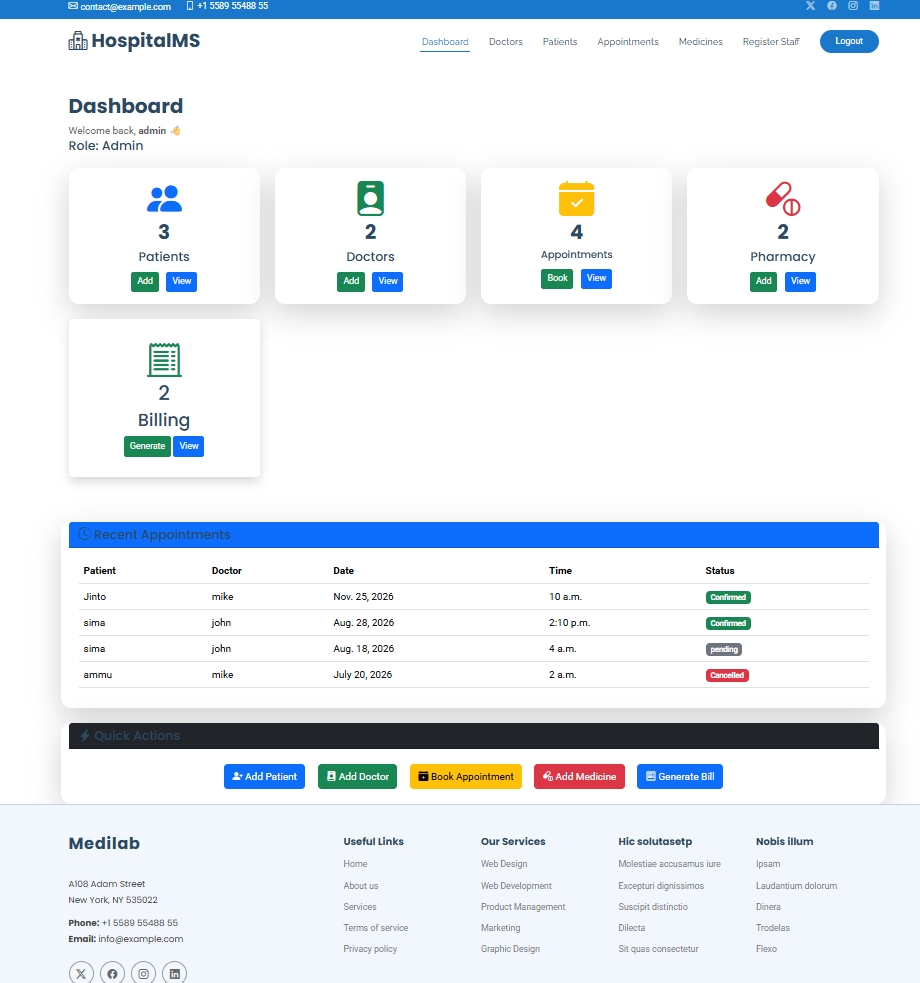
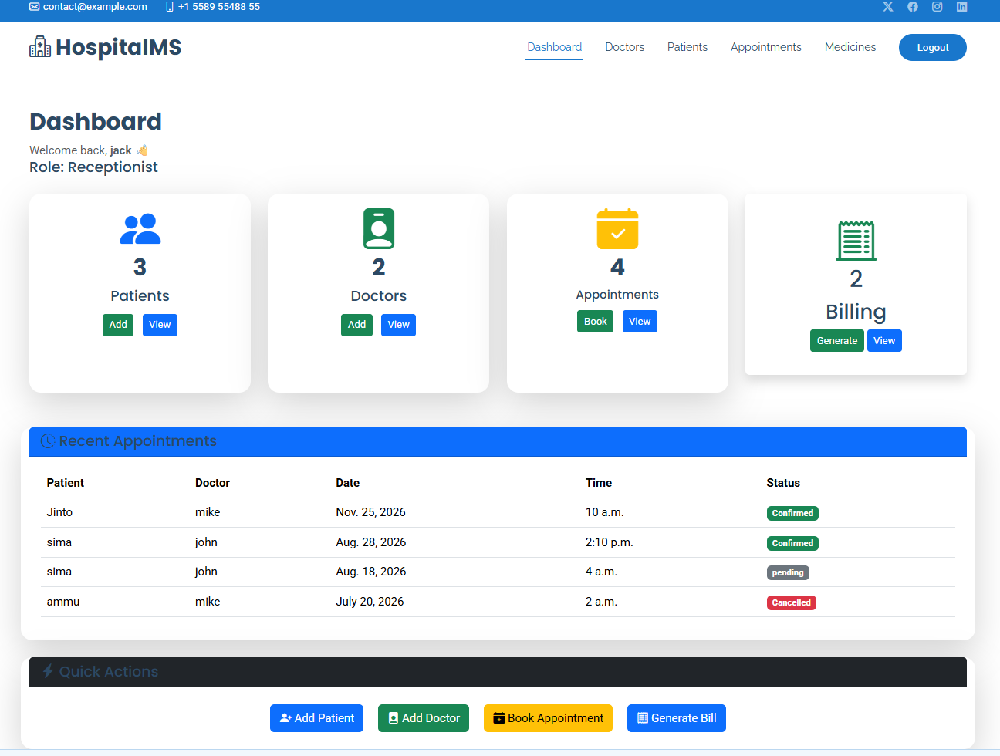
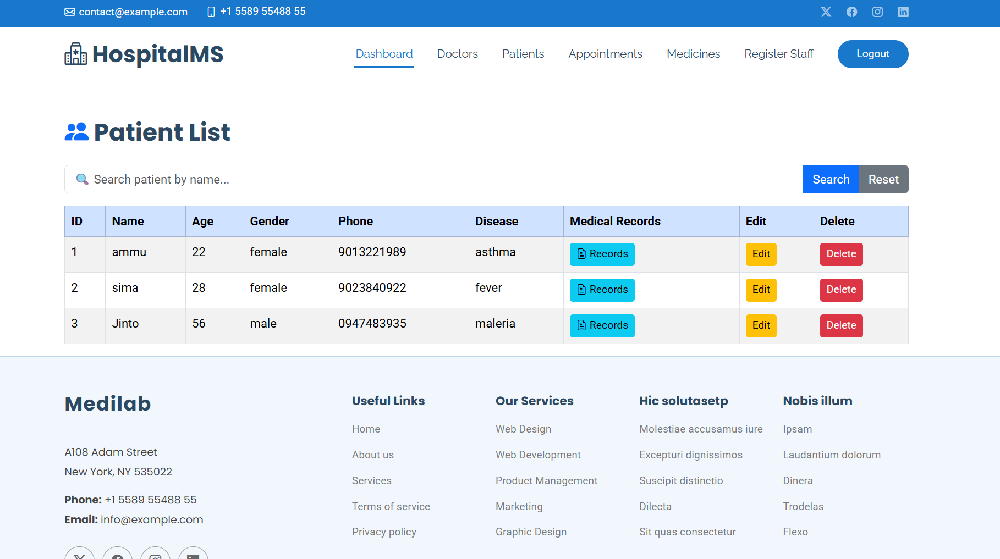
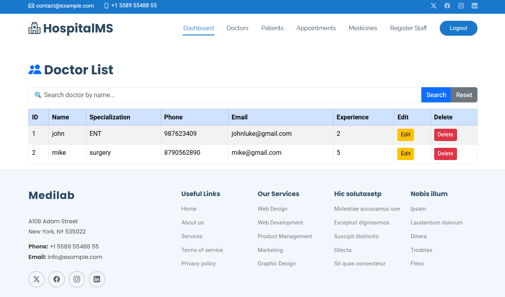
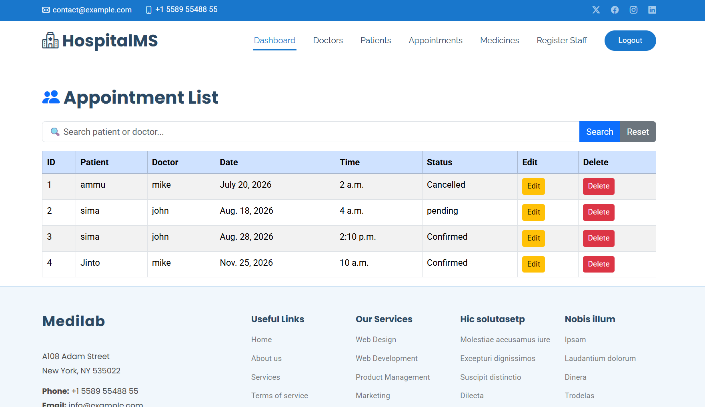
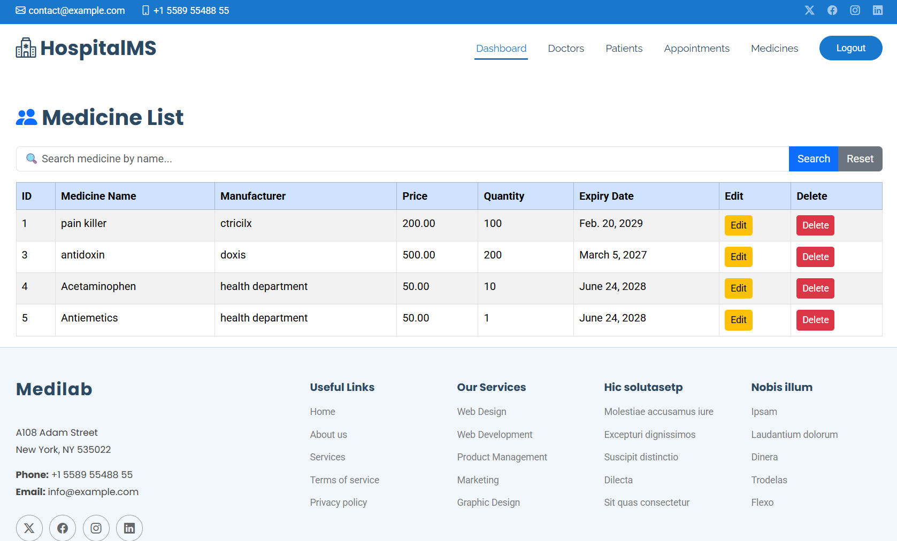
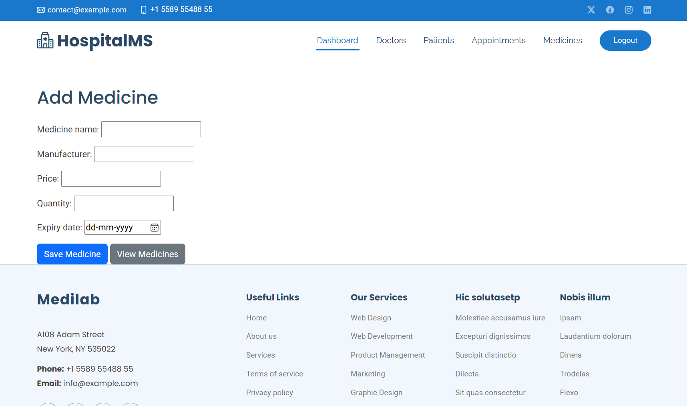
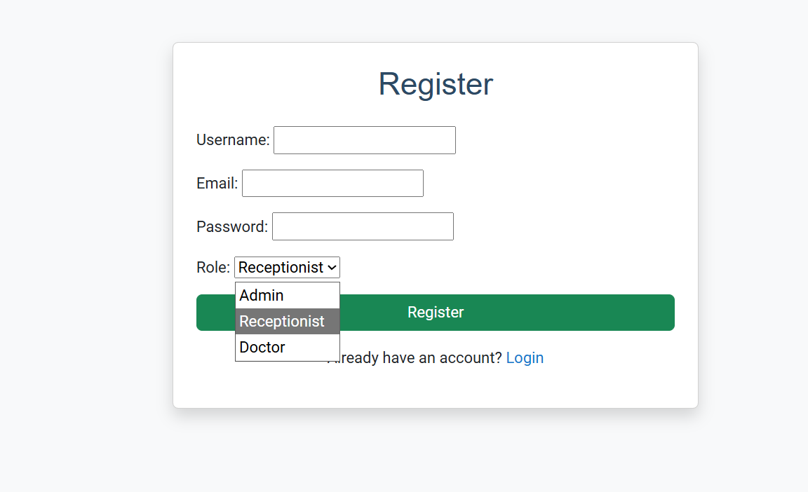

# 🏥 Hospital Management System

A web-based Hospital Management System built using **Python and Django**. The system helps hospital staff manage patients, doctors, appointments, medicines, medical reports, and billing through a centralized interface.

The application also includes **role-based access control** for Admin, Doctor, and Receptionist users.

---

## 📌 Features

### 🔐 Authentication & Role-Based Access

- Secure login system
- Role-based access for:
  - Admin
  - Doctor
  - Receptionist
- Public registration is restricted
- Only Admin can register new staff accounts
- Role-based access to system features and actions
- Logout functionality

### 🏠 Dashboard

- Centralized dashboard
- Displays system information based on user access
- Shows counts of patients, doctors, appointments, pharmacy, and billing
- Shows recent appointments
- Quick access to available features

### 👤 Patient Management

- Add patients
- View patient details
- Edit patient information
- Delete patients
- Search patients by name
- View patient medical records

### 👨‍⚕️ Doctor Management

- Add doctors
- View doctor details
- Edit doctor information
- Delete doctors
- Search doctors by name
- Role-based restrictions for doctor management actions

### 📅 Appointment Management

- Book appointments
- View appointments
- Edit appointments
- Delete appointments
- Search appointments by patient or doctor
- Appointment status management:
  - Confirmed
  - Pending
  - Cancelled
- Appointment clash checking

### 💊 Medicine Management

- Add medicines
- View medicines
- Edit medicine details
- Delete medicines
- Search medicines by name

### 📄 Medical Reports

- Add medical reports for patients
- Upload medical report files
- View patient medical records
- View and download reports
- Delete reports
- Access reports through the patient records section
- Role-based access to medical reports

### 🧾 Billing

- Generate bills
- View billing records
- Generate billing receipts
- Delete billing records

---

## 🛠️ Technologies Used

- Python
- Django
- SQLite
- HTML5
- CSS3
- Bootstrap 5
- JavaScript

---

## 📂 Project Structure

```text
Hospital-Management-System/
│
├── config/                 # Django project configuration
├── projectapp/             # Main application
│   └── migrations/         # Database migrations
├── static/                 # Static files
│   └── assets/
├── templates/              # HTML templates
├── media/                  # Uploaded medical reports
├── screenshots/            # README screenshots
├── manage.py
├── .gitignore
└── README.md
```

## Screenshots

### Admin Dashboard


### Doctor Dashboard


### Receptionist Dashboard

### Admin: View, Add and Edit Pages

The Admin can see, add and edit everything in the system: patients, doctors, appointments, medicines, medical reports and billing.










